# Arquitetura MLOps: Diagrama de Deploy na AWS (O Presente - 2023)

Como ainda estamos em 2023, nossa prioridade ao final do treinamento é pegar o modelo aprovado (`enem.pkl`) e colocá-lo "vivo" na internet, esperando pelo momento que o INEP liberará os dados no futuro.

Este diagrama ilustra exatamente essa etapa intermediária (O Deploy):

```mermaid
graph LR
    classDef model fill:#fce4ec,stroke:#c2185b,stroke-width:2px;
    classDef code fill:#e1f5fe,stroke:#0288d1,stroke-width:2px;
    classDef aws fill:#fff9c4,stroke:#fbc02d,stroke-width:2px;
    classDef cicd fill:#ede7f6,stroke:#512da8,stroke-width:2px;

    M1("Modelo Treinado (enem.pkl)")
    class M1 model;

    subgraph Fase1 ["1. Encapsulamento (Desenvolvimento)"]
        C1("Código Python (FastAPI)")
        C2("Containerização (Docker)")
    end
    class C1,C2 code;

    subgraph Fase2 ["2. Automação (CI/CD)"]
        D1("GitHub Actions (Pipeline)")
    end
    class D1 cicd;

    subgraph Fase3 ["3. Infraestrutura em Nuvem (AWS)"]
        AWS1("Amazon ECR (Registro de Imagens)")
        AWS2("AWS App Runner / ECS (Servidor)")
        AWS3("Endpoint da API URL Pública")
    end
    class AWS1,AWS2,AWS3 aws;

    %% Conexões
    M1 -->|"Embarcado no servidor web"| C1
    C1 -->|"Empacotado em uma imagem"| C2
    C2 -.->|"Push / Commit"| D1
    D1 -->|"Faz o push da Imagem"| AWS1
    AWS1 -->|"Executa o container"| AWS2
    AWS2 -->|"Expõe para acesso"| AWS3
```

