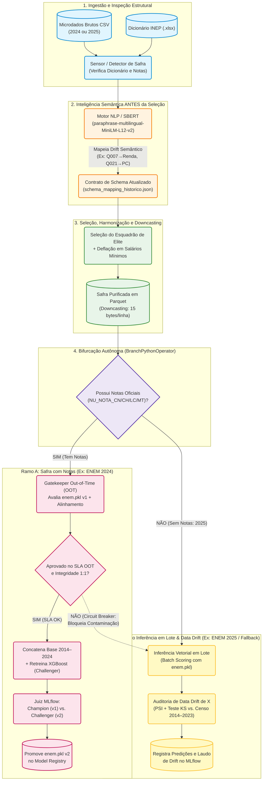

# Arquitetura MLOps: Diagrama da Etapa 3 (Orquestração Autônoma Airflow 2024/2025 — Plano Pesado Local)

Por governança de **FinOps**, toda a carga pesada de Engenharia de Dados e Machine Learning (varredura de milhões de linhas em CSV, *embeddings* neurais com **PyTorch/SBERT**, retreinamento censitário do **XGBoost** e rastreamento no **MLflow**) roda **localmente containerizada em Docker**, evitando custos ociosos na nuvem AWS.

Abaixo está o fluxo arquitetural homologado da DAG autônoma (`enem_autonomous_pipeline_dag`), corrigindo a precedência obrigatória do **NLP/SBERT sobre o dicionário antes da seleção de colunas** e implementando a **bifurcação inteligente entre safras com notas (2024) e safras sem notas (2025)**:

---

## Detalhamento Técnico dos 4 Estágios da DAG

1. **Estágio 1 — Ingestão e Detecção Estrutural:** Localiza automaticamente os arquivos CSV (`PARTICIPANTES_<ANO>.csv`, `RESULTADOS_<ANO>.csv` ou `MICRODADOS_ENEM_<ANO>.csv`) e a planilha oficial de dicionário `.xlsx` da edição.
2. **Estágio 2 — NLP/SBERT no Dicionário (Antes da Seleção):** Antes de abrir o CSV de milhões de linhas, o modelo neural `paraphrase-multilingual-MiniLM-L12-v2` lê as descrições textuais do dicionário novo e descobre por similaridade de cosseno (com restrição injetiva do Algoritmo Húngaro) quais códigos de colunas correspondem às 6 variáveis canônicas (ex.: detectando automaticamente que em 2024 e 2025 a renda familiar mudou de `Q006` para `Q007` e a posse de computador mudou de `Q024` para `Q021`).
3. **Estágio 3 — Seleção, Harmonização de *Value Drift* e *Downcasting*:** Lê apenas as colunas mapeadas em *chunks*, converte a renda em múltiplos de Salários Mínimos por morador (`RENDA_PER_CAPITA`), harmoniza as categorias e comprime o resultado em Parquet (`snappy`, `15 bytes/linha`).
4. **Estágio 4 — Bifurcação Inteligente e *Circuit Breaker* de Governança:**
   * **Se a safra possui notas e alinhamento íntegro:** Executa a validação *Out-of-Time* com o modelo `Champion (v1)`. Se o erro e o $R^2$ cumprirem o SLA, concatena `2014–2024`, treina o `Challenger` e usa o **MLflow** para decidir a promoção de `enem.pkl v2`.
   * **Se a safra não possui notas (`2025`) ou se o Gatekeeper detectar quebra de integridade referencial entre arquivos bipartidos (`2024` desidentificado pelo INEP):** O *Circuit Breaker* impede a contaminação do Data Lake de treinamento e desvia os participantes para **Inferência em Lote (*Batch Scoring*) + Auditoria de *Data Drift* de $X$ (PSI / KS)**.
