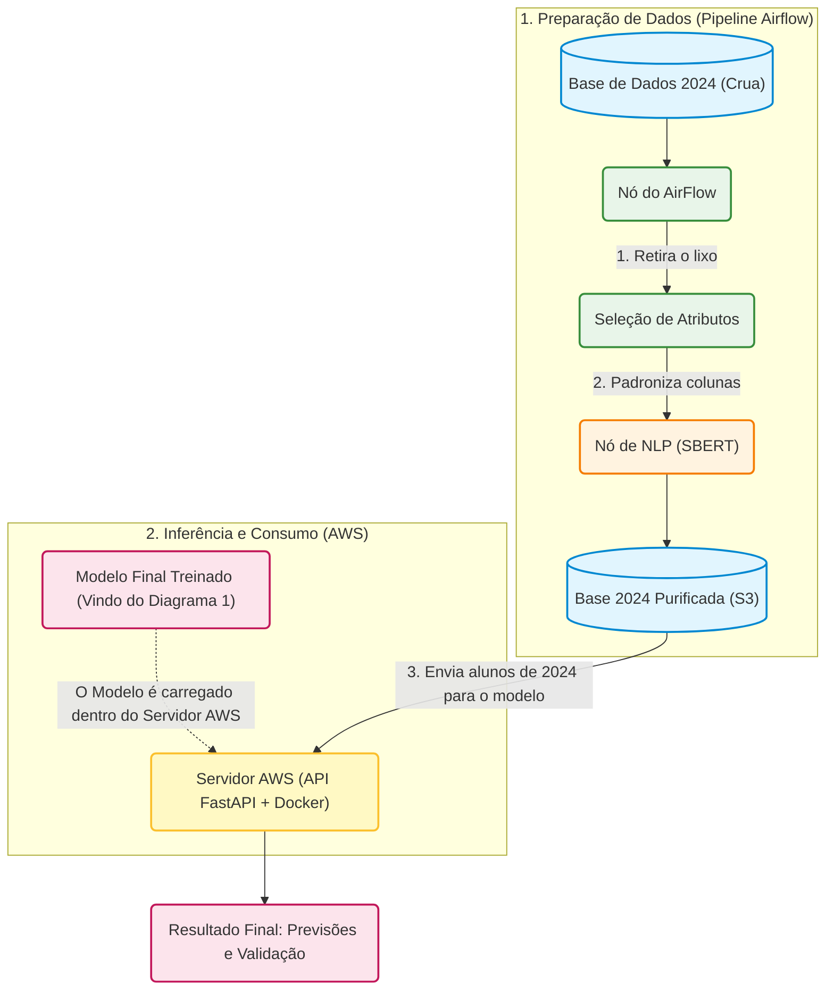

# Arquitetura MLOps: Diagrama 2 (Pipeline de Produção 2024)

Este diagrama representa o cenário futuro. Aqui, não estamos mais treinando o modelo, estamos **usando** o modelo para prever a nota dos alunos da nova base de 2024.

