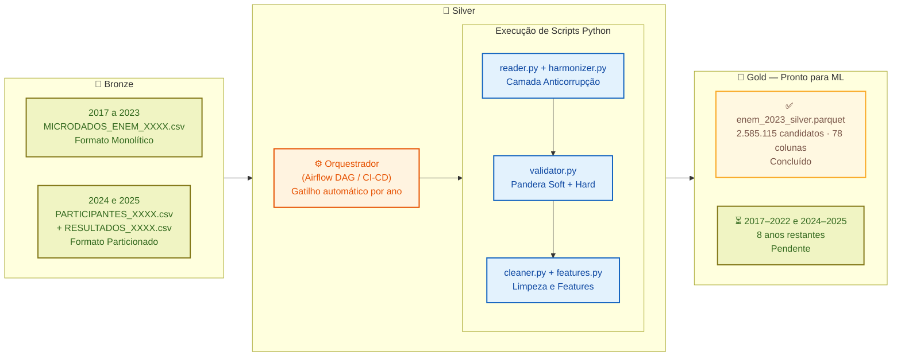
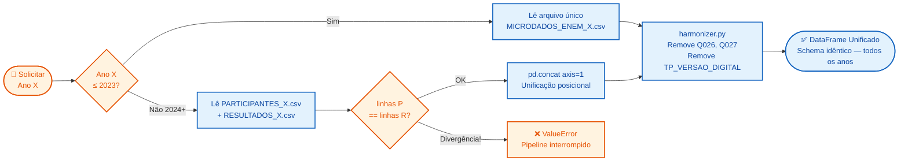
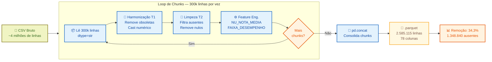
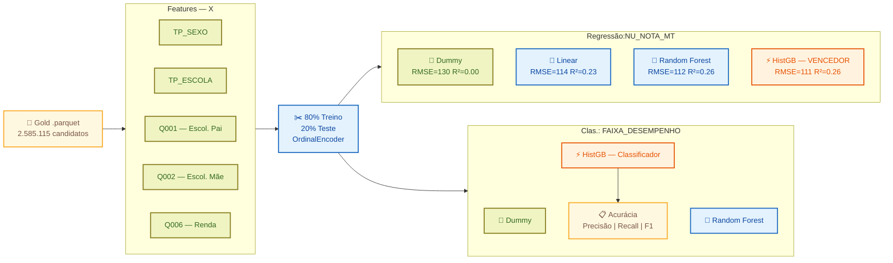
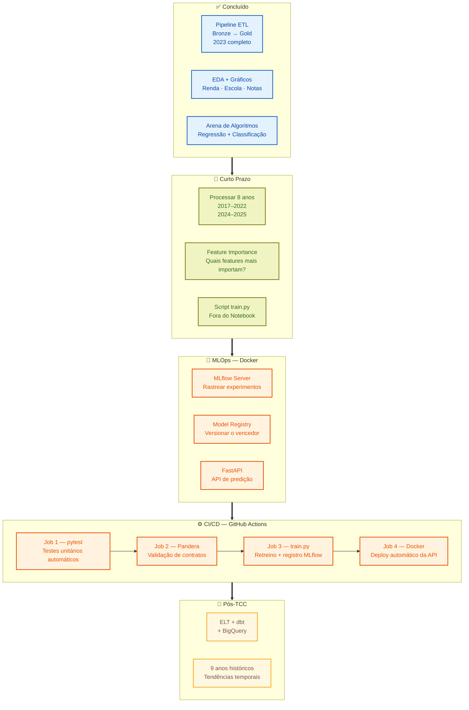
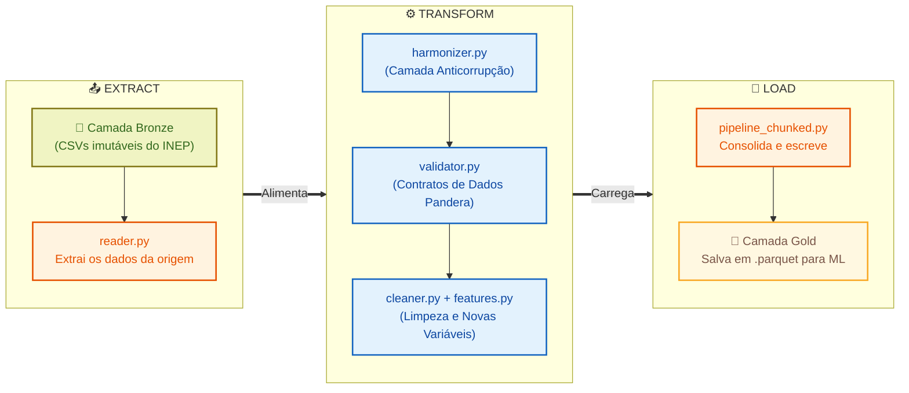
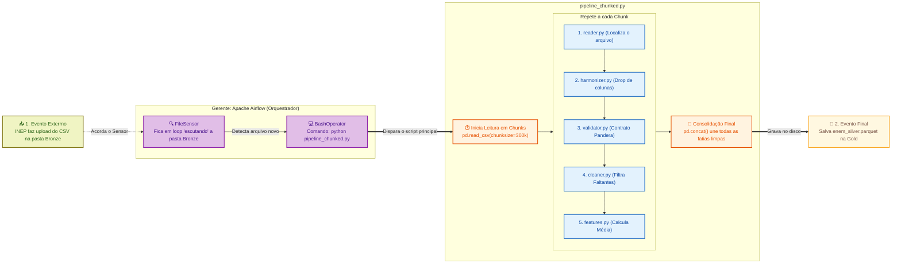
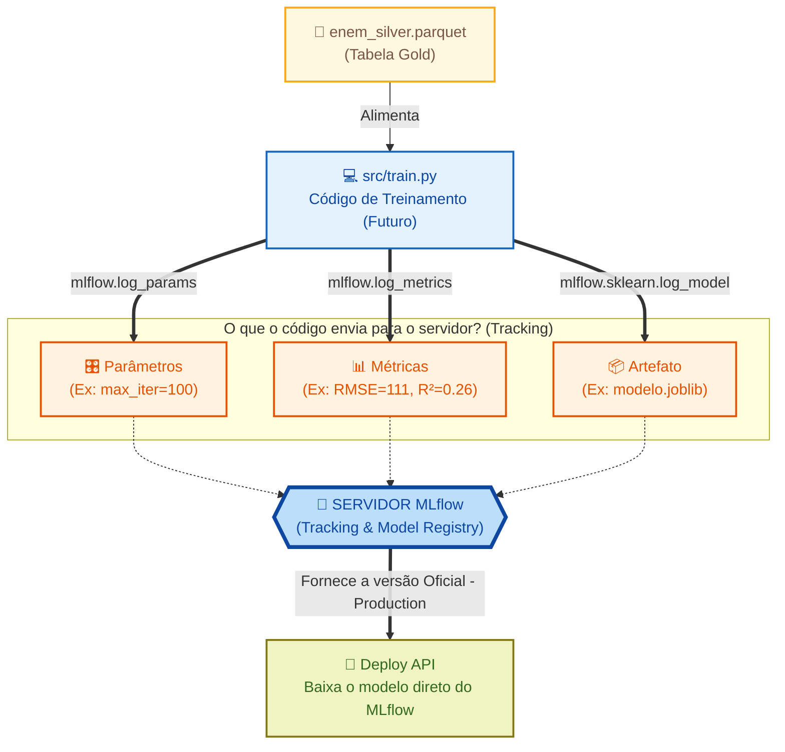

# Diagramas Mermaid — TCC ENEM MLOps
**Data:** 19/09/2026 | Estilo visual adaptado do padrão do TCC

---

## Diagrama 1 — Arquitetura Geral do Pipeline MLOps

```mermaid
flowchart LR
    classDef base fill:#f0f4c3,stroke:#827717,stroke-width:2px,color:#33691e;
    classDef core fill:#e3f2fd,stroke:#1565c0,stroke-width:2px,color:#0d47a1;
    classDef govern fill:#fff3e0,stroke:#e65100,stroke-width:2px,color:#e65100;
    classDef gold fill:#fff8e1,stroke:#f9a825,stroke-width:2px,color:#795548;

    L1["🗄️ Infraestrutura<br/>WSL + .venv + Docker"]:::base

    subgraph L_Core ["Fluxo de Dados — ETL Defensivo"]
        direction LR
        L2["📥 Ingestão<br/>reader.py + harmonizer.py"]:::core
        L3["🛡️ Soft Validation<br/>Pandera"]:::core
        L4["🧹 Limpeza<br/>cleaner.py"]:::core
        L5["⚙️ Feature Eng.<br/>features.py"]:::core
        L6["✅ Hard Validation<br/>Pandera"]:::core
        L7["💾 Data Lake<br/>.parquet — Camada Gold"]:::gold
        L2 ==> L3 ==> L4 ==> L5 ==> L6 ==> L7
    end

    L8["🔬 Laboratório ML<br/>EDA + Modelagem"]:::govern
    L9["🏆 Produção<br/>train.py + MLflow"]:::govern

    L1 -. "Sustenta" .-> L_Core
    L7 -. "Alimenta" .-> L8
    L8 -. "Promove" .-> L9
```

---

## Diagrama 2 — Arquitetura Medalhão (Bronze / Silver / Gold)

---

## Diagrama 3 — Camada Anticorrupção: reader.py + harmonizer.py

---

## Diagrama 4 — Pipeline Chunked: Processando 4 Milhões de Linhas

---

## Diagrama 5 — Arena de Algoritmos: Regressão e Classificação

---

## Diagrama 6 — Roadmap do Projeto

---

## Diagrama 7 — Visão Macro: O Pipeline ETL vs Arquitetura Medalhão

Este diagrama ilustra como os scripts Python (o motor) executam os verbos do **ETL** para movimentar e transformar os dados através dos estados da **Arquitetura Medalhão**.

---

## Diagrama 8 — Visão de Orquestração: O Ciclo de Vida com Apache Airflow

Este diagrama mapeia o fluxo completo de "causa e efeito": desde o momento em que um arquivo cai na Camada Bronze até o acionamento do Airflow, que por sua vez dispara a esteira de processamento em chunks do nosso código Python.

---

## Diagrama 9 — Visão MLOps: Integração com MLflow (O Coração do Treinamento)

Este diagrama isola a etapa de treinamento do Machine Learning. Ele mostra como o script futuro (`src/train.py`) se comunicará com o Servidor MLflow para registrar absolutamente tudo o que acontece durante o treino, garantindo rastreabilidade e controle de versão.

