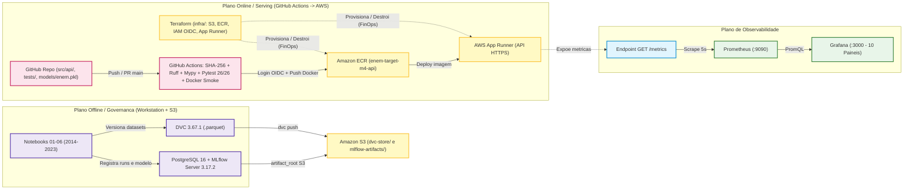

# Arquitetura MLOps: Planos Desacoplados (Workstation Containerizada + Nuvem AWS)

O recorte histórico do projeto foi encerrado em **2023** devido à ruptura estrutural da **LGPD** a partir de `2024` (separação de `PARTICIPANTES` e `RESULTADOS` sem chave identificadora pelo INEP). A capacidade de generalização temporal é comprovada no Notebook 06 via **Validação *Out-of-Time* Interna (`2014–2022 -> 2023`, $R^2 = 0{,}31842$)**.

Com as evoluções das **Fases 1 a 4**, o repositório opera sob uma **Arquitetura Desacoplada por Planos (*Local-to-Cloud MLOps*)**:

1. **Plano Offline / Governança (`profiles: ["mlops"]` + Amazon S3):** `PostgreSQL 16` + `MLflow Tracking Server 3.17.2` + `DVC 3.67.1` armazenam dados pesados (`.parquet` em `dvc-store/`) e artefatos/modelos (`mlflow-artifacts/`) em bucket S3 privado (`AES256`, versionamento habilitado).
2. **Plano Online / *Serving* (`GitHub Actions + Terraform + AWS`):** [`models/enem.pkl`](../models/enem.pkl) embarcado na API **FastAPI** (`Docker multi-stage`, `515 MB` Content Size), validado por CI (`SHA-256` + `ruff` + `mypy` + `26` testes `pytest` + *Docker Smoke Test*), publicado no **Amazon ECR** via **IAM OIDC** e servido pelo **AWS App Runner** sob demanda FinOps (`infra/`).
3. **Plano de Observabilidade (`profiles: ["monitoring"]`):** a API expõe `GET /metrics` (`prometheus-client==0.26.0`), coletado pelo **Prometheus** (`:9090`) e exibido no **Grafana** (`:3000`) com 10 painéis de SLA HTTP, bloqueios Anti-Leakage (`HTTP 422`) e *Data/Prediction Drift*.

