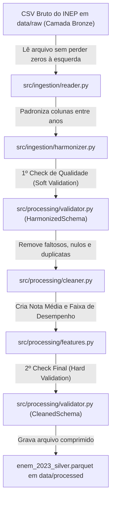

# Onde Tudo Começa: Guia Simples do Primeiro Código Executável do Projeto

> **Público-alvo:** Este relatório foi escrito para quem está começando a ler o código do projeto e quer entender, sem jargões difíceis, **qual foi o primeiro programa que realmente rodou de ponta a ponta** (descartando tentativas iniciais apagadas) e **como cada arquivo conectado a ele funciona**.
>
> **Nota de arquivamento:** Durante a faxina do repositório em `17/11/2026`, os arquivos originais dessa fase de setembro (`src/pipeline.py`, `src/pipeline_chunked.py`, `src/ingestion/`, `src/processing/`, `desenvolvimento-15-09-26.md` e `enem_2023_silver.parquet`) foram removidos da branch `main` (pois a esteira definitiva foi construída nos Notebooks `01` a `06` + `src/api/`). Todo esse código histórico permanece salvo e consultável na tag Git **`archive/pre-faxina-2026-11`** (ex.: `git show archive/pre-faxina-2026-11:src/pipeline.py`).

---

## 1. O susto inicial é normal: por que o `pipeline.py` chama outros arquivos?

Quando você abre `src/pipeline.py`, percebe logo nas primeiras linhas que ele importa códigos de outras duas pastas:
- `src/ingestion/`
- `src/processing/`

Isso acontece por uma regra clássica de organização chamada **separação de responsabilidades** (como uma fábrica ou um restaurante):

* Se um único arquivo fizesse **tudo** (achar arquivos no computador, corrigir datas antigas, limpar candidatos faltosos, conferir erros, criar médias novas e salvar no disco), ele ficaria gigante e impossível de dar manutenção.
* Em vez disso, o `src/pipeline.py` funciona como o **Maestro (ou Gerente da Fábrica)**: ele não executa cada tarefa braçal sozinho — ele chama **5 arquivos especialistas** na ordem exata, confere se deu tudo certo e entrega o produto final pronto.

---

## 2. Qual foi o primeiro código executado neste projeto?

Desconsiderando rascunhos e tentativas anteriores que foram eliminadas, o **ponto de partida real e operacional do projeto** foi a execução de `src/pipeline.py` (em **15/09/2026**).

Antes de ele existir, os arquivos auxiliares nas pastas `ingestion/` e `processing/` estavam escritos de forma isolada, como peças soltas em cima de uma bancada. Foi o `pipeline.py` que **conectou todas essas peças pela primeira vez** e processou dados reais do **ENEM 2023**, gerando o arquivo limpo `data/processed/enem_2023_silver.parquet`.

### Visão geral do time que trabalha junto

| Pasta | Arquivo | Papel na "Fábrica" (para leigos) | Status atual |
| :--- | :--- | :--- | :--- |
| **`src/`** | `pipeline.py` | **O Maestro:** coordena as 5 etapas em ordem e salva o resultado | *Arquivado na tag `archive/pre-faxina-2026-11`* |
| **`src/ingestion/`** | `reader.py` | **O Almoxarife:** acha o CSV certo nas pastas do INEP e o abre com segurança | *Arquivado na tag `archive/pre-faxina-2026-11`* |
| **`src/ingestion/`** | `harmonizer.py` | **A Alfândega:** adapta diferenças entre anos e descarta colunas obsoletas | *Arquivado na tag `archive/pre-faxina-2026-11`* |
| **`src/processing/`** | `validator.py` | **O Fiscal de Qualidade:** barra dados quebrados na entrada e na saída | *Arquivado na tag `archive/pre-faxina-2026-11`* |
| **`src/processing/`** | `cleaner.py` | **A Equipe de Faxina:** tira ausentes, eliminados, nulos e repetidos | *Arquivado na tag `archive/pre-faxina-2026-11`* |
| **`src/processing/`** | `features.py` | **O Setor de Indicadores:** cria a média geral e classifica o desempenho | *Arquivado na tag `archive/pre-faxina-2026-11`* |

---

## 3. O que faz cada arquivo que o `pipeline.py` carrega?

### Pasta 1: `src/ingestion/` — Entrada e Padronização dos Dados

O objetivo desta pasta é ler os arquivos originais do INEP (**Camada Bronze**, que nunca é alterada) e entregá-los em formato padrão para o restante do sistema.

#### A) `src/ingestion/reader.py` — *Quem encontra e abre o arquivo*
Os microdados do ENEM são arquivos gigantes em texto (`.csv`) e o INEP mudou a forma como organiza as pastas ao longo do tempo:

1. **Achar a pasta certa (`find_file`):**
   - Até 2022, os dados ficavam em `data/raw/enem_ANO/DADOS/`.
   - De 2023 em diante, o INEP colocou uma subpasta extra no caminho (`microdados_enem_ANO/DADOS/`). O `reader.py` resolve isso automaticamente para o restante do código não precisar se preocupar.
2. **Abrir sem estragar códigos (`read_microdata`):**
   - Lê usando ponto e vírgula (`;`) como separador e codificação `latin-1` (para não quebrar acentos em português).
   - **Detalhe inteligente (`dtype=str`):** ele manda o Python ler **tudo inicialmente como texto**. Por quê? Porque se o computador tentar adivinhar números na leitura, um código de inscrição ou escola que comece com `"0"` (ex.: `"01234"`) perde o zero à esquerda e vira `1234`. Ler como texto protege esses códigos.
3. **Sobre a leitura dividida (`read_microdata_positional_split`):**
   - No início do projeto (setembro/2026), havia a expectativa de que os anos de **2024 em diante** — que vieram divididos pelo INEP em dois arquivos (`PARTICIPANTES` e `RESULTADOS`) — pudessem ser colados lado a lado linha por linha (desde que tivessem exatamente a mesma quantidade de linhas).
   - **Nota importante da evolução do projeto:** mais tarde (novembro/2026), comprovou-se que o INEP separou e desvinculou propositalmente essas duas tabelas em 2024 e 2025 por causa da **LGPD**, tornando impossível cruzá-las por candidato. Por isso, o projeto oficial encerra a série histórica em **2023** (usando a leitura única `read_microdata`).

#### B) `src/ingestion/harmonizer.py` — *A Camada Anticorrupção*
Mesmo nos arquivos únicos, o questionário do ENEM muda de um ano para outro. O `harmonizer.py` evita que essas mudanças quebrem os passos seguintes:

1. **Roteamento automático (`load_and_harmonize_auto`):** decide qual função do `reader.py` chamar conforme o ano (`<= 2023` arquivo único; `> 2023` particionado).
2. **Limpeza de colunas passageiras (`drop_obsolete_columns`):** apaga colunas que existiram em apenas alguns anos e não fazem parte da base padrão contínua:
   - `Q026` e `Q027` (perguntas antigas extintas a partir de 2019);
   - `TP_VERSAO_DIGITAL` (coluna que existiu apenas na edição de 2020, por causa do ENEM Digital).

---

### Pasta 2: `src/processing/` — Qualidade, Limpeza e Enriquecimento

Depois que os dados entram padronizados, entram em ação os três especialistas desta pasta.

#### C) `src/processing/validator.py` — *O Fiscal de Contratos (Pandera)*
Em vez de torcer para os dados estarem bons, o projeto usa uma biblioteca chamada **Pandera** para criar **Contratos de Dados** — como um fiscal com prancheta verificando regras rígidas em dois momentos diferentes:

1. **Fiscal de Entrada — *Soft Validation* (`HarmonizedSchema`):**
   - Roda logo depois que os dados chegam do `harmonizer.py`.
   - Confere se a coluna `NU_ANO` está entre `2017` e `2025` e se as 5 notas (`NU_NOTA_CN`, `NU_NOTA_CH`, `NU_NOTA_LC`, `NU_NOTA_MT`, `NU_NOTA_REDACAO`) estão entre `0` e `1000`.
   - **Pulo do gato:** neste ponto, ele **ainda aceita notas em branco (`nullable=True`)**, porque os candidatos que faltaram à prova ainda estão na tabela e serão removidos na etapa seguinte.
2. **Fiscal de Saída — *Hard Validation* (`CleanedSchema`):**
   - Roda bem no final, imediatamente antes de salvar o arquivo no disco.
   - Agora a tolerância a nota vazia é **zero** (`nullable=False`): nenhuma das 5 provas pode ter buraco em branco, todas têm de estar entre `0` e `1000`, e existe uma trava que **proíbe salvar uma tabela vazia (`len(df) > 0`)**.
   - Se qualquer regra falhar, o sistema para na hora (*Fail-fast*) com uma mensagem de erro clara, impedindo que dados corrompidos sigam adiante silenciosamente.

#### D) `src/processing/cleaner.py` — *A Equipe de Faxina*
A função principal `clean_data` aplica quatro limpezas obrigatórias em sequência:

1. **Filtrar apenas quem realmente fez todas as provas (`filter_present_participants`):**
   - Mantém somente candidatos com presença confirmada (`== '1'`) nas **4 provas objetivas** (`TP_PRESENCA_CN`, `TP_PRESENCA_CH`, `TP_PRESENCA_LC`, `TP_PRESENCA_MT`) **e** com redação válida sem problemas (`TP_STATUS_REDACAO == '1'`).
   - *Por que `'1'` entre aspas?* Porque o `reader.py` leu tudo como texto na entrada!
2. **Remover notas vazias residuais (`drop_missing_scores`):**
   - Elimina qualquer linha que ainda tenha algum campo vazio em qualquer uma das 5 notas.
3. **Eliminar inscrições repetidas (`drop_duplicates`):**
   - Garante que cada candidato (`NU_INSCRICAO`) apareça apenas uma única vez.
4. **Converter textos para números de verdade (`cast_dtypes`):**
   - Só agora, depois que os códigos estão protegidos e os ausentes foram embora, transforma as 5 notas em números decimais (`float`) e o ano em número inteiro (`int`).

#### E) `src/processing/features.py` — *O Setor de Novos Indicadores*
Depois da tabela limpa, a função `feature_engineering` calcula duas colunas novas que não vêm prontas nos dados do INEP:

1. **`NU_NOTA_MEDIA` (`create_average_score`):** soma as 5 notas do candidato (`CN`, `CH`, `LC`, `MT` e `REDACAO`) e divide por 5, criando a média geral individual.
2. **`FAIXA_DESEMPENHO` (`create_performance_categories`):** transforma essa média numérica em um rótulo fácil de entender para análises e gráficos:
   - Abaixo de `450` → **`"Insuficiente"`**
   - De `450` até menos de `600` → **`"Regular"`**
   - De `600` até menos de `750` → **`"Bom"`**
   - `750` ou mais → **`"Excelente"`**

---

## 4. O que acontece passo a passo quando você roda o `pipeline.py`?

Quando alguém executa `python src/pipeline.py`, o bloco final (`if __name__ == "__main__":`) chama a função `run_pipeline` passando o ano `2023`. Dentro dela, acontecem 6 passos em fila:

1. **Etapa 1 — Ingestão e Harmonização (`T1`):** chama `harmonizer.py` (que chama `reader.py`), carrega o CSV do ENEM 2023 como texto (ou apenas `10.000` linhas se o modo teste `nrows=10000` estiver ligado), registra a coluna `NU_ANO = 2023` e conta quantas linhas brutas entraram (`linhas_brutas`).
2. **Etapa 2 — *Soft Validation*:** converte temporariamente as 5 notas de texto para número decimal (`pd.to_numeric`), mantém as colunas de presença como texto, e passa tudo pelo primeiro fiscal (`validate_harmonized_data`).
3. **Etapa 3 — Limpeza (`T2`):** entrega a tabela ao `clean_data` (`cleaner.py`), calcula quantos candidatos restaram (`linhas_limpas`) e imprime no log quantos foram eliminados por falta, eliminação, nota nula ou duplicidade.
4. **Etapa 4 — Engenharia de Atributos (`T3/T4`):** entrega a tabela limpa ao `feature_engineering` (`features.py`) para criar `NU_NOTA_MEDIA` e `FAIXA_DESEMPENHO`.
5. **Etapa 5 — *Hard Validation*:** submete a tabela final ao segundo fiscal (`validate_cleaned_data`). Se não houver nenhum nulo nas notas e a tabela não estiver vazia, libera a gravação.
6. **Carga (*Load*):** cria a pasta `data/processed/` (se ainda não existir) e salva tudo no arquivo binário colunar **`data/processed/enem_2023_silver.parquet`** (sem gravar o número da linha como coluna extra).

### Por que salvar em `.parquet` e não em `.csv`?
Para um leigo, pense no `.csv` como uma folha de texto enorme e pesada, onde cada número é escrito caractere por caractere e sem saber se é texto ou número. Já o **Apache Parquet (`.parquet`)** é um formato industrial compactado e organizado por colunas: ele ocupa muito menos espaço em disco, guarda o tipo exato de cada coluna e carrega em segundos no Python.

---

## 5. O que foi gerado na prática quando esse código rodou?

De acordo com os registros históricos de execução do projeto (`desenvolvimento-15-09-26.md` na tag `archive/pre-faxina-2026-11` e [`docs/resumo-apresentacao-tcc-19-09-26.md`](file:///home/saulo/mba/tcc/enem/docs/resumo-apresentacao-tcc-19-09-26.md)):

* **Primeiro teste rápido (`nrows=10000`):**
  - Entraram `10.000` linhas do ENEM 2023.
  - Sobraram `7.114` registros válidos (`2.886` ou **28,9%** removidos por falta/eliminação).
* **Base completa do ENEM 2023 (`enem_2023_silver.parquet` — *removida na faxina*):**
  - Entraram **`3.933.955`** candidatos inscritos no CSV original.
  - Permaneceram **`2.585.115`** candidatos elegíveis com todas as provas válidas (**`1.348.840`** ou **34,3%** removidos).
  - Artefato originalmente salvo em `data/processed/enem_2023_silver.parquet` com **`78` colunas** e **`346,97 MB`** de tamanho.

---

## 6. Como isso evoluiu para o restante do TCC?

Este fluxo de `src/pipeline.py` foi a fundação de todo o trabalho:

1. **4 dias depois (`19/09/2026`):** como tentar carregar milhões de linhas de uma vez pressionava a memória RAM, foi criado o `src/pipeline_chunked.py` (*também preservado na tag `archive/pre-faxina-2026-11`*), que reaproveita as funções de `reader.py`, `harmonizer.py`, `cleaner.py` e `features.py` processando o CSV em blocos ("chunks") de **300.000 linhas** por vez.
2. **Em seguida (`outubro–novembro/2026`):** a equipe consolidou a análise exploratória, seleção das 6 variáveis socioeconômicas finais, mapeamento histórico de 10 anos (`2014–2023`) e treinamento do modelo preditivo nos **Notebooks `01` a `06`** (gerando [`enem_2014_2023_consolidado.parquet`](file:///home/saulo/mba/tcc/enem/data/processed/enem_2014_2023_consolidado.parquet) e [`models/enem.pkl`](file:///home/saulo/mba/tcc/enem/models/enem.pkl)), além da API em [`src/api/`](file:///home/saulo/mba/tcc/enem/src/api/).
