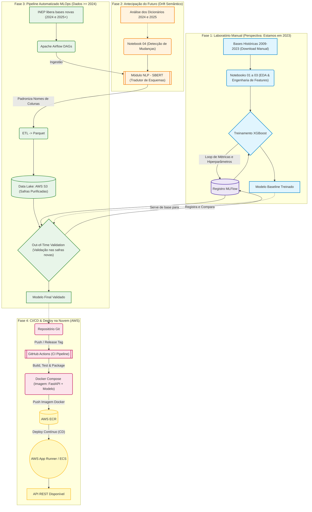

# Arquitetura do Projeto: Previsão do ENEM (MLOps)

O diagrama abaixo ilustra o fluxo temporal e tecnológico do projeto, evidenciando a premissa de "viagem no tempo" (estar em 2023 projetando o futuro de 2024/2025) e as etapas de MLOps.

