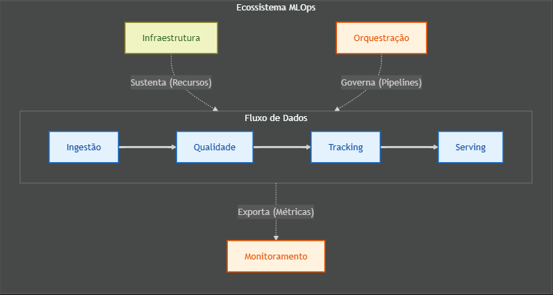

TÍTULO: ARQUITETURA DE MLOPS PARA PREDIÇÃO DE DESEMPENHO NO ENEM: UM PIPELINE ESCALÁVEL E DEFENSIVO
====================================================================================================

**Autor:** Saulo Santos **Curso:** MBA em Machine Learning em Produção

RESUMO
------

Este trabalho apresenta o desenvolvimento de uma arquitetura completa de MLOps (*Machine Learning Operations*) voltada para a análise preditiva dos microdados do Exame Nacional do Ensino Médio (ENEM) referentes às edições de 2017 a 2025. O objetivo principal é projetar e implementar um pipeline escalável e resiliente capaz de automatizar o ciclo de vida de modelos preditivos, cujo propósito é estimar o desempenho dos participantes com base em variáveis socioeconômicas e educacionais. Para solucionar o desafio da inconsistência estrutural dos dados ao longo de quase uma década, propõe-se uma arquitetura de software híbrida, combinando o padrão Pipeline para o tratamento de dados, Orquestração de Serviços via Apache Airflow e Microsserviços para o provimento das inferências. Os resultados preliminares demonstram a eficácia da construção de uma camada anticorrupção (harmonização) e da imposição de contratos estritos de dados.

**Palavras-chave:** MLOps, ENEM, Engenharia de Dados, Machine Learning, Arquitetura de Software.

1. INTRODUÇÃO
-------------

### 1.1 Contextualização

A aplicação de técnicas de Machine Learning no setor educacional tem viabilizado a extração de inteligência a partir de grandes bases de dados, auxiliando na compreensão dos fatores que afetam o desempenho acadêmico. O Exame Nacional do Ensino Médio (ENEM), conduzido pelo Instituto Nacional de Estudos e Pesquisas Educacionais Anísio Teixeira (INEP), gera anualmente microdados robustos que correlacionam notas de avaliação ao perfil socioeconômico de milhões de participantes.

Entretanto, o desenvolvimento de modelos preditivos sobre bases de dados históricas e longitudinais depara-se com o problema da inconsistência estrutural: variáveis mudam de nomenclatura, codificações categóricas são alteradas e restrições legais (como a Lei Geral de Proteção de Dados - LGPD) forçam a supressão de atributos. Além disso, a transição de um modelo de Machine Learning do ambiente de experimentação (Jupyter Notebooks) para um ambiente de produção exige rigor em engenharia de software, automação e monitoramento contínuo, preceitos que fundamentam a disciplina de MLOps.

### 1.2 Problema de Pesquisa

Como projetar e implementar uma arquitetura de MLOps robusta, resiliente a mudanças de *schema* ao longo dos anos, capaz de realizar a carga histórica única dos microdados do ENEM, suportar execuções anuais incrementais para novas edições e disponibilizar inferência escalável em ambiente AWS para um grande volume de usuários?

### 1.3 Objetivos

**Objetivo Geral:**

Desenvolver e implantar um pipeline completo de Machine Learning (MLOps) para a predição do desempenho e a classificação das faixas de rendimento dos participantes do ENEM, contemplando a ingestão histórica dos microdados, a atualização anual da base de dados e a disponibilização escalável do modelo em ambiente AWS.

**Objetivos Específicos:**

-   **Implementar uma camada de ingestão defensiva capaz de harmonizar as divergências estruturais dos microdados do ENEM referentes ao período de 2017 a 2025.**

-   **Incorporar princípios da Engenharia de Software Defensiva ao pipeline de MLOps por meio de validações, contratos de dados e mecanismos de isolamento de falhas, visando aumentar a confiabilidade do processamento.**

-   **Aplicar contratos de dados para validar a estrutura e a consistência dos microdados antes das etapas de processamento e treinamento dos modelos.**

-   **Avaliar modelos de regressão e classificação para a predição do desempenho e das faixas de rendimento dos participantes, utilizando um ambiente de experimentação rastreável por meio do MLflow.**

-   **Estruturar a disponibilização dos modelos segundo uma arquitetura baseada em microsserviços, garantindo desacoplamento entre treinamento e inferência e permitindo escalabilidade horizontal em ambiente AWS.**

-   **Implementar mecanismos de observabilidade e monitoramento da infraestrutura e dos modelos em produção, permitindo o acompanhamento da execução do pipeline e da qualidade das predições.**

-   **Definir uma estratégia de atualização anual do pipeline para acomodar novas edições do ENEM, mediante revisão das DAGs de orquestração e dos componentes afetados por alterações na estrutura dos microdados.**

-   **Planejar a separação entre o processamento histórico em lote (*batch processing*) e a inferência online (*online inference*), preservando a independência entre os serviços e a continuidade operacional do sistema.**

-   **Desenvolver um dashboard interativo para visualização dos resultados, exploração das predições e acompanhamento das métricas produzidas pelos modelos.**

2. REFERENCIAL TEÓRICO
----------------------

### 2.1 Machine Learning em Produção (MLOps)

O conceito de MLOps surge da necessidade de unificar o desenvolvimento de sistemas de aprendizado de máquina (ML) e a operação de software (Ops). Trata-se da automação de todo o ciclo de vida do modelo, abrangendo desde a extração e validação de dados, passando pelo treinamento, registro, implantação contínua (CI/CD) e monitoramento do modelo contra degradações silenciosas, como o *Data Drift* e o *Concept Drift*.

### 2.2 Arquitetura de Software Híbrida para Dados

O projeto de sistemas orientados a dados em produção frequentemente exige a combinação de estilos arquiteturais. A adoção de um estilo **Pipeline (*Pipes and Filters*)** mostra-se adequada para as fases de tratamento e limpeza (onde o fluxo de dados passa por filtros isolados e sequenciais). Por outro lado, a gestão assíncrona dessas etapas requer um **Serviço Baseado em Orquestração**, onde um componente central (orquestrador) coordena a ordem lógica e o tratamento de falhas. Finalmente, para garantir escalabilidade sob demanda no consumo do modelo preditivo, o padrão de **Microsserviços** isola a responsabilidade de inferência da responsabilidade de treinamento.

3. METODOLOGIA
--------------

Esta pesquisa caracteriza-se como de natureza aplicada, com abordagem quantitativa e experimental. O desenvolvimento do projeto foi estruturado à luz do paradigma de Engenharia de Software Defensiva, que prioriza a construção de sistemas resilientes em operar mesmo em situações imprevistas e de entradas inconsistentes (Sommerville, 2011).

Segundo McConnell (2004) a programação defensiva deve ser orientada pela validação dos dados de entrada. O autor propõe três diretrizes: validar informações de fontes externas, verificar a consistência dos parâmetros recebidos pelas rotinas e estabelecer políticas para o tratamento de entradas inválidas. Essas práticas reduzem a propagação de erros e aumentam a confiabilidade do software.

McConnell (2004) afirma ainda que, em softwares executados em ambiente de produção, a lógica de Garbage In, Garbage Out não é aceitável, pois um sistema de qualidade não deve produzir resultados incorretos em decorrência de entradas inválidas. Em vez disso, o software deve impedir a propagação dessas inconsistências, adotando estratégias como *Garbage In, Nothing Out ou Garbage In, Error Message Out*.

Dessa forma, considerando os princípios da Engenharia de Software Defensiva e a necessidade de validação dos dados ao longo de todo o processo de desenvolvimento, a metodologia foi estruturada para contemplar o ciclo de vida do aprendizado de máquina. Para isso, o ecossistema foi organizado em sete camadas lógicas de MLOps, apresentadas na Figura 3.1.

Figura 3.1 - As Sete Camadas Lógicas de MLOps do Projeto

{width="6.13125in" height="3.2736111111111112in"}

*Fonte: O Autor (2026).*

A camada de infraestrutura sustenta os recursos computacionais necessários à execução do sistema; a camada de ingestão absorve as particularidades externas dos microdados; a camada de qualidade assegura a validade formal das informações processadas; a camada de orquestração coordena o fluxo de execução; a camada de *tracking* registra experimentos e artefatos; a camada de *serving* disponibiliza o modelo para consumo; e a camada de monitoramento encerra o ciclo, oferecendo visibilidade sobre o comportamento operacional do sistema em produção.

### 3.1 Arquitetura

A arquitetura de software constitui um dos elementos centrais para a qualidade de sistemas complexos, uma vez que estabelece a organização estrutural dos componentes, suas responsabilidades e os mecanismos de interação entre eles. Em aplicações de ciência de dados e aprendizado de máquina, essa definição adquire relevância em razão da necessidade de integrar serviços distintos, responsáveis por ingestão, processamento, treinamento, disponibilização e monitoramento de modelos preditivos.

No presente trabalho, a arquitetura foi concebida para atender a dois cenários operacionais complementares. O primeiro corresponde à carga histórica única dos microdados do ENEM referentes aos últimos 9 anos, etapa na qual o sistema realiza a consolidação inicial da base de dados. O segundo refere-se à operação continuada em regime anual, por meio da incorporação de novas edições futuras, o que exigirá a reavaliação dos scripts sempre que houver modificações na estrutura dos dados disponibilizados pelo INEP.

Sistemas orientados a dados e baseados em aprendizado de máquina apresentam requisitos distintos daqueles observados em aplicações convencionais. Enquanto uma parcela do sistema executa tarefas de processamento em lote (*batch processing*), outra demanda resposta em tempo real (*online inference*). Por isso, neste projeto, uma única abordagem arquitetural não seria suficiente.

A solução adotada combina diferentes estilos arquiteturais, conforme os princípios de decisão arquitetural e análise de *trade-offs* discutidos por Richards e Ford (2025). A escolha levou em conta robustez, rastreabilidade, modularidade, isolamento de falhas e escalabilidade, com atenção à integridade do processamento histórico e à disponibilidade da camada de consumo.

Para o processamento dos dados, foi adotado o padrão Pipes and Filters citado por Richards e Ford (2025, p. 181) que descrevem a arquitetura de pipeline como uma unidade de implantação com filtros conectados por *pipes* unidirecionais. Cada etapa executa uma função específica e envia sua saída para a etapa seguinte. Neste trabalho, esse padrão foi implementado em memória, o que reduz operações em disco e favorece modularidade, baixo acoplamento e validação progressiva dos dados. Essa decisão mostrou-se particularmente apropriada para a fase de ingestão e harmonização, na qual os dados percorrem transformações sequenciais, normalização estrutural e validações formais antes de serem encaminhados às etapas posteriores.

A execução do *pipeline* foi coordenada por um mecanismo de orquestração implementado com o **Apache Airflow**. Essa plataforma permite modelar fluxos de trabalho como grafos acíclicos dirigidos (*DAGs*), sendo responsável pelo agendamento das tarefas, pelo gerenciamento das dependências entre as etapas, pelo monitoramento da execução e pela reexecução automática em caso de falhas. No contexto deste projeto, o Airflow é um orquestrador de *workflows*, compatível com a natureza dos microdados do ENEM, disponibilizados em lotes e não em fluxo contínuo. Tal característica reforça a adequação da orquestração centralizada, sobretudo para a carga histórica inicial e para as execuções anuais futuras, as quais poderão demandar ajustes específicos nas *DAGs* em função de eventuais alterações na estrutura, na granularidade ou na organização dos arquivos publicados pelo INEP.

Os serviços responsáveis pela inferência dos modelos e pela visualização dos resultados foram implementados segundo o paradigma de **microsserviços**. Essa separação reduz o acoplamento entre os componentes, possibilita escalabilidade independente e evita que picos de demanda na camada de inferência comprometam a execução do *pipeline* de treinamento. Além disso, a segregação entre processamento em lote e consumo online contribui para reduzir o risco de indisponibilidade mútua entre rotinas de engenharia de dados e serviços de predição, permitindo evolução independente de cada camada do sistema.

Essa organização está alinhada aos princípios da Engenharia de Software Defensiva, pois reduz a propagação de falhas, facilita o isolamento de erros e permite mecanismos específicos de validação, monitoramento e recuperação. Assim, um problema localizado tende a ficar restrito ao serviço afetado, sem comprometer o restante do sistema.

A infraestrutura foi planejada para implantação em AWS, com foco em escalabilidade horizontal, alta disponibilidade e separação entre os *workloads* de processamento e consumo. Essa decisão considera uma estimativa de cerca de milhões de participantes atendidos pelo sistema, o que exige elasticidade da camada de *serving* e boa capacidade de resposta sob picos de acesso.

A Figura 3.2 apresenta a arquitetura organizada em sete camadas lógicas, com as responsabilidades de cada uma e os frameworks e módulos utilizados. Docker e WSL2 sustentam o ambiente de execução. A ingestão é feita pelos módulos `reader.py` e `harmonizer.py`, responsáveis pela leitura dos microdados e pela harmonização estrutural e semântica. A qualidade dos dados é garantida por contratos de dados. A orquestração fica a cargo do Apache Airflow. O MLflow registra experimentos, métricas e artefatos. A camada de *serving* usa FastAPI e Streamlit para disponibilizar o modelo via API e interface web. O monitoramento emprega Evidently e Grafana para acompanhar desempenho, deriva dos dados e saúde operacional.

Em síntese, a arquitetura combina processamento sequencial de dados, orquestração de workflows e serviços de inferência desacoplados. Essa estrutura atende à consolidação da base histórica, à incorporação de novas edições e à demanda de usuários em ambiente AWS.

Figura 3.2 - As Sete Camadas Lógicas de MLOps do Projeto

                
    Fonte: O Autor (2026).

### 3.2 Ingestão de Dados e a Camada Anticorrupção

A etapa inicial de ingestão tem como objetivo ler, organizar e padronizar os microdados brutos disponibilizados pelo INEP. Como a base utilizada neste trabalho reúne edições do ENEM ao longo de aproximadamente uma década, surgem diferenças de nomenclatura, de codificação e de disponibilidade de variáveis, além de supressões motivadas por exigências legais, como as relacionadas à LGPD.

Para lidar com essas variações, foi adotada uma camada anticorrupção baseada no padrão Anti-Corruption Layer (ACL), proposto por Evans (2003) no contexto de Domain-Driven Design (DDD). No projeto, essa camada é formada principalmente pelos módulos reader.py e harmonizer.py, que separam a leitura dos arquivos da normalização semântica e estrutural dos dados. Com isso, o restante do pipeline não precisa tratar diretamente as particularidades do formato original dos microdados.

#### **3.2.1 Abstração de acesso aos dados**

As edições de 2024 e 2025 do ENEM introduziram uma mudança importante na estrutura de distribuição dos microdados. Até 2023, todas as informações vinham em um único arquivo (MICRODADOS_ENEM_XXXX.csv). A partir de 2024, o INEP desmembrou essa base em dois arquivos distintos: PARTICIPANTES_XXXX.csv (dados de perfil e questionário socioeconômico) e RESULTADOS_XXXX.csv (notas e gabaritos). Essa cisão exige um tratamento específico, porque não seria adequado repassar essa complexidade para as demais etapas do sistema.

Nesse contexto, o módulo reader.py foi criado para abstrair o acesso aos arquivos. Para edições até 2023, realiza a leitura direta do arquivo único. Para edições a partir de 2024, lê ambos os arquivos e executa um JOIN via chave primária (NU_INSCRICAO), reconstruindo em memória o formato monolítico esperado pelo restante do pipeline.

Nesse contexto, o módulo reader.py foi criado para abstrair o acesso aos arquivos e reconstruir, em memória, uma estrutura única a partir dos fragmentos. Na prática, ele faz uma leitura inicial dos cabeçalhos, identifica as colunas relevantes para o projeto e carrega apenas os atributos necessários. Depois, consolida os arquivos em um único *dataframe*, oferecendo ao pipeline uma interface estável de consumo.

Essa solução reduz a complexidade de entrada e saída, evita condicionais específicas por ano e facilita a manutenção do código. O restante da aplicação passa a trabalhar com uma estrutura uniforme, independentemente da forma como os dados foram distribuídos na origem.

#### **3.2.2 Normalização semântica e estrutural**

Depois da leitura, os dados seguem para o módulo harmonizer.py, responsável por ajustar o *dataset* ao esquema interno do projeto. Esse módulo executa a tradução lexical e semântica dos dados, de modo a compatibilizar o vocabulário do INEP com a estrutura esperada pelo pipeline.

Uma parte desse trabalho envolve a padronização dos nomes das colunas. Em várias edições, o mesmo tipo de informação aparece com nomenclaturas diferentes, como ocorre com a remoção das questões socioeconômicas Q026 e Q027 a partir de 2019, ou com a presença da coluna transitória TP_VERSAO_DIGITAL exclusiva da edição de 2020. O harmonizador corrige essas divergências para evitar que diferenças formais sejam interpretadas como inconsistências reais.

Além disso, o módulo também trata mudanças nos códigos categóricos. Em bases históricas extensas, é comum que uma mesma variável mantenha o nome, mas altere os valores internos ao longo dos anos. No projeto, isso ocorre, por exemplo, com variáveis ligadas ao questionário socioeconômico, cuja disponibilidade varia entre as edições para representações internas mais estáveis. Esse procedimento permite comparar edições distintas sem perder coerência semântica.

Outro ponto importante é a adequação às exigências da LGPD. Alguns atributos sensíveis, especialmente os que podem favorecer a identificação indireta de estudantes, são removidos quando aparecem em edições mais antigas. Essa decisão mantém a consistência entre os anos e evita o uso de informações que não devem seguir adiante no pipeline.

#### **3.2.3 Benefícios arquiteturais**

A adoção da camada anticorrupção traz benefícios diretos para a evolução do sistema. Como a leitura dos dados fica separada da sua normalização, o código deixa de depender de regras específicas para cada edição do ENEM. Isso reduz o número de condicionais, simplifica a lógica de processamento e facilita ajustes futuros.

Outro ganho importante é a estabilidade do pipeline. Quando os módulos posteriores recebem apenas dados já harmonizados, a chance de falhas causadas por diferenças históricas diminui. Em um contexto de aprendizado de máquina, essa estabilidade é relevante porque pequenas mudanças estruturais podem afetar a construção de features, a coerência do treinamento e a qualidade das previsões.

Essa organização também ajuda a preservar a fronteira entre o domínio externo e o ambiente analítico interno. Em vez de adaptar o restante do sistema a cada mudança na origem dos dados, o projeto concentra essa tarefa nos módulos de fronteira. O resultado é uma arquitetura mais limpa, mais fácil de manter e mais preparada para novas edições do ENEM.

#### **3.2.4 Implementação prática dos padrões**

A implementação dessa estratégia ocorre por meio de dois módulos principais: reader.py e harmonizer.py. O primeiro trata da leitura dos arquivos do ENEM, incluindo a reconstrução de uma estrutura unificada para as edições de 2024 e 2025, nas quais o INEP desmembrou a base em dois arquivos distintos (`PARTICIPANTES` e `RESULTADOS`). O segundo aplica as regras de harmonização necessárias para adequar os dados ao contexto interno do projeto, tratando divergências como a remoção de questões socioeconômicas e colunas transitórias entre edições. Em conjunto, eles materializam a camada anticorrupção e evitam que o restante do sistema precise lidar com as particularidades da fonte externa.

Essa separação também torna o pipeline mais transparente e mais simples de manter. Quando cada responsabilidade fica restrita a um componente específico, o fluxo de processamento passa a ser mais compreensível para novos desenvolvedores e mais fácil de evoluir ao longo do tempo. Além disso, a divisão entre leitura, tradução de esquema e remoção de campos sensíveis reduz a complexidade cognitiva do sistema e melhora sua organização.

Em síntese, a ingestão de dados funciona como uma etapa de fronteira, na qual a heterogeneidade dos microdados do ENEM é tratada antes de os dados seguirem para as fases analíticas do pipeline. A camada anticorrupção, apoiada pelos padrões Façade, Adapter e Translator, contribui para preservar a consistência do sistema, facilitar sua manutenção e aumentar sua robustez diante de mudanças estruturais nos dados ao longo do tempo.

    # Trecho de src/ingestion/reader.py (Padrão Façade / Adapter)
    def read_microdata(data_dir: str, year: int) -> pd.DataFrame:
        """
        Façade que abstrai a diferença estrutural entre edições do ENEM.
        Até 2023: arquivo único MICRODADOS_ENEM_XXXX.csv.
        A partir de 2024: dois arquivos (PARTICIPANTES + RESULTADOS).
        """
        if year <= 2023:
            # Padrão Façade: o pipeline externo não precisa saber o formato de origem.
            filepath = find_microdata_file(data_dir, year)
            return pd.read_csv(filepath, sep=";", encoding="latin-1", dtype=str)
        else:
            # Padrão Adapter: converte o "protocolo" do INEP (dois arquivos separados)
            # no "protocolo" que o sistema entende (um DataFrame consolidado).
            df_part = pd.read_csv(
                find_file(data_dir, year, "PARTICIPANTES"),
                sep=";", encoding="latin-1", dtype=str)
            df_result = pd.read_csv(
                find_file(data_dir, year, "RESULTADOS"),
                sep=";", encoding="latin-1", dtype=str)
            # A interface adaptada devolve a ilusão de um arquivo monolítico único
            return df_part.merge(df_result, on="NU_INSCRICAO", how="inner")

Uma vez que os dados são abstraídos pelo *Façade*, eles são passados para o `harmonizer.py`, que atua como o **Translator** da Camada Anticorrupção, normalizando o esquema estrutural e garantindo paridade temporal entre as edições:

    # Trecho de src/ingestion/harmonizer.py (Padrão Translator da Camada Anticorrupção)
    def drop_obsolete_columns(df: pd.DataFrame, year: int) -> pd.DataFrame:
        """Defesa Estrutural: Garante paridade temporal entre edições do ENEM."""
        # Q026 e Q027 foram removidas pelo INEP a partir de 2019
        if year >= 2019:
            cols = [c for c in ["Q026", "Q027"] if c in df.columns]
            df = df.drop(columns=cols)
        # TP_VERSAO_DIGITAL existe apenas em 2020 (ENEM Digital)
        if "TP_VERSAO_DIGITAL" in df.columns:
            df = df.drop(columns=["TP_VERSAO_DIGITAL"])
        return df

### 3.3 Qualidade de Dados: Implementação de Contratos (Data Contracts)

A confiabilidade de um sistema orientado a dados depende não apenas da obtenção e da transformação corretas das informações, mas também da validação contínua de sua integridade estrutural e semântica. Em pipelines de *Machine Learning*, essa preocupação é ainda mais importante, porque inconsistências não detectadas em etapas anteriores tendem a seguir para o treinamento e para a inferência, afetando a qualidade dos resultados.

Segundo Avizienis et al. (2004), é importante distinguir os conceitos de *Fault* (*Defeito*), *Error* (*Erro*) e *Failure* (*Falha*). Um defeito interno pode gerar um erro, que se torna uma falha quando alcança a interface externa do sistema. Nesse cenário, o fenômeno da *Silent Data Corruption* (SDC) descreve situações em que os dados são alterados sem que a execução seja interrompida, permitindo que informações corrompidas avancem para etapas posteriores sem detecção explícita (Constantinescu et al., 2008).

Kleppmann (2017) observa que, em sistemas intensivos em dados, a aceitação tácita de anomalias sem a geração de falhas explícitas leva à degradação silenciosa das predições, o que se relaciona ao problema conhecido como *Garbage In, Garbage Out* (GIGO). No contexto deste trabalho, isso significa que um pipeline pode concluir sua execução sem erros aparentes, mas ainda assim produzir um conjunto de dados inconsistente, capaz de comprometer o treinamento dos modelos.

Para reduzir esse risco, foi adotado o padrão de **Contratos de Dados** (*Data Contracts*), entendido como um acordo formal sobre tipagem, estrutura, domínio de valores e semântica esperados para cada base consumida pelo sistema. Essa abordagem coloca a qualidade dos dados como uma responsabilidade explícita de engenharia, e não como uma verificação informal feita apenas ao final do processo.

A implementação dos contratos foi feita com a biblioteca **Pandera**, que permite validar *dataframes* por meio de esquemas declarativos em Python. Com isso, cada etapa do pipeline passa a ser acompanhada por regras objetivas de conformidade, capazes de verificar se os dados permanecem dentro das condições esperadas.

#### **3.3.1 Validação em dois estágios**

A estratégia de validação foi dividida em dois estágios para equilibrar flexibilidade e rigor. O primeiro estágio, chamado **Validação Flexível** ou *Soft Validation*, ocorre logo após a harmonização. Nessa fase, admite-se a presença de algumas ausências, especialmente na variável-alvo, porque certos registros ainda serão tratados na etapa de limpeza. O objetivo principal é verificar se o *schema* básico está correto e se os limites numéricos esperados estão sendo respeitados.

    # Trecho de src/processing/validator.py (Padrão de Data Contract - Soft Validation)
    import pandera as pa
    from pandera import Column, DataFrameSchema

    harmonized_schema = DataFrameSchema({
        "ANO": Column(int, pa.Check.in_range(2017, 2025), nullable=False),
        # As notas ainda podem conter nulos nesta etapa inicial
        "NU_NOTA_MT": Column(float, pa.Check.in_range(0, 1000), nullable=True),
        "NU_NOTA_REDACAO": Column(float, pa.Check.in_range(0, 1000), nullable=True),
    }, strict=False, name="HarmonizedSchema")

O segundo estágio, chamado **Validação Rígida** ou *Hard Validation*, ocorre ao final do processamento, antes da gravação do conjunto consolidado. Aqui, os critérios são mais estritos: o pipeline não pode seguir adiante se houver valores nulos na variável-alvo, se o *DataFrame* estiver vazio ou se alguma regra essencial for violada. Essa etapa tem caráter *fail-fast*, pois transforma inconsistências residuais em falhas explícitas, impedindo que dados inadequados sejam usados no treinamento.

Essa estrutura em duas camadas acompanha a lógica do processamento de dados. Em um primeiro momento, o sistema admite que certas irregularidades ainda podem ser corrigidas. Mais adiante, porém, exige conformidade total antes da consolidação final. Assim, reduz-se o risco de interrupções desnecessárias sem abrir mão da integridade do resultado.

    # Trecho de src/processing/validator.py (Padrão de Data Contract - Hard Validation)
    cleaned_schema = DataFrameSchema({
        "ANO": Column(int, pa.Check.in_range(2017, 2025), nullable=False),
        # As notas NÃO PODEM conter nulos. Se contiverem, o Pandera quebra a execução.
        "NU_NOTA_MT": Column(float, pa.Check.in_range(0, 1000), nullable=False),
        "NU_NOTA_REDACAO": Column(float, pa.Check.in_range(0, 1000), nullable=False),
    }, 
    checks=[
        # Impede que o pipeline passe adiante um arquivo vazio (ex: erro no filtro de participantes)
        pa.Check(lambda df: len(df) > 0, error="O DataFrame não deve estar vazio")
    ], strict=False, name="CleanedSchema")

#### **3.3.2 Schema harmonizado**

O schema intermediário é aplicado logo após a harmonização e verifica atributos essenciais para a continuidade do pipeline, como a existência da coluna de ano, a consistência dos tipos de dados e a validade do intervalo numérico da variável-alvo. Essa etapa confirma que os dados já foram convertidos para uma estrutura compatível com o contexto interno do projeto, embora ainda possam conter registros incompletos a serem tratados depois.

Sua função é impedir que problemas de leitura, variações de formato ou incongruências estruturais mais evidentes avancem sem controle. Em bases históricas como a do ENEM, isso é relevante porque pequenas diferenças de schema entre edições podem afetar bibliotecas de manipulação tabular e comprometer a reprodutibilidade das análises. Assim, a validação intermediária atua como uma barreira entre a harmonização e o refinamento analítico.

#### **3.3.3 Schema final consolidado**

Após a limpeza e do enriquecimento das variáveis, o conjunto é submetido ao schema final, mais restritivo. Nessa etapa, a variável-alvo não pode conter nulos, o *DataFrame* não pode estar vazio e as colunas fundamentais precisam continuar dentro dos limites definidos. O objetivo é garantir que o artefato final possa ser utilizado com segurança nas etapas de treinamento e avaliação dos modelos.

Essa validação mais rígida é importante porque, em ambiente de produção, um conjunto de dados aparentemente válido pode ser mais perigoso do que uma falha explícita. Ao interromper a execução diante de qualquer desvio, o sistema evita a propagação de resultados espúrios e preserva a rastreabilidade do problema. Isso reforça a postura defensiva adotada ao longo do projeto.

#### **3.3.4 Contribuição para a robustez do pipeline**

Os contratos de dados em dois estágios aumentam a robustez do sistema porque formalizam as expectativas sobre a base e transferem a verificação para um mecanismo explícito e programático. Em vez de assumir que os arquivos de entrada estão corretos, o pipeline passa a verificar continuamente se os dados ainda atendem às condições esperadas em cada etapa crítica.

Essa organização também melhora a manutenção do projeto, já que as regras de qualidade ficam concentradas em componentes específicos e podem ser ajustadas sem impacto sobre o restante da arquitetura. Além disso, a separação entre validação flexível e rígida permite acompanhar a natureza incremental do processamento sem comprometer a consistência do resultado final.

Em síntese, a implementação de contratos de dados com Pandera cria uma camada formal de proteção contra falhas silenciosas. Com isso, os conjuntos de dados só avançam no pipeline quando atendem aos requisitos mínimos de estrutura, tipo e completude, o que fortalece a confiabilidade da preparação dos dados e sustenta as etapas seguintes de treinamento e disponibilização dos modelos.

### 3.4 Processamento, Engenharia de Atributos e Exportação (O Restante do ETL)

Conceitualmente, o pipeline ETL projetado atua em múltiplas camadas de transformação. A fase de Ingestão, discutida na Seção 3.2, corresponde apenas à Extração (E) e à Harmonização Estrutural (T1). A fase de Processamento, por sua vez, compreende as camadas subsequentes: Limpeza de Dados (T2), Padronização (T3) e Engenharia de Atributos (T4), culminando na Carga (L) do artefato analítico final no *Data Lake*. O módulo de contratos de dados atua como um guardião rigoroso entre essas duas grandes fases, garantindo que apenas dados que cumpram os requisitos básicos de qualidade avancem para o preparo voltado aos modelos preditivos.

O módulo `cleaner.py` é responsável pela camada de Limpeza (T2). Ele remove observações que não contribuem para a modelagem, como participantes ausentes à prova, registros incompletos e linhas duplicadas. Essa higienização segue a lógica de programação defensiva do projeto, com o objetivo de reduzir ruídos e impedir que dados estatisticamente irrelevantes corrompam o fluxo de *Machine Learning*.

Em seguida, o módulo `features.py` unifica a Padronização (T3) e a Engenharia de Atributos (T4), produzindo novas variáveis a partir das informações higienizadas. Nesse ponto, as notas do ENEM (`NU_NOTA_MT`, `NU_NOTA_LC`, `NU_NOTA_CN`, `NU_NOTA_CH`, `NU_NOTA_REDACAO`), originalmente contínuas na escala de 0 a 1000, também passam a ser tratadas em formato categorizado, por meio da definição de faixas de desempenho. Essa transformação amplia o alcance analítico do projeto, pois permite construir modelos voltados não apenas à estimativa numérica da nota, mas também à classificação do desempenho em grupos mais interpretáveis. O resultado final dessa cadeia é salvo (Load) de forma otimizada em `.parquet`.

#### 3.4.1 Transformação da variável-alvo

As notas do ENEM são mantidas como variáveis contínuas para experimentos de regressão e, ao mesmo tempo, convertidas em categorias discretas para experimentos de classificação. Essa estratégia foi adotada porque as duas abordagens são complementares: a regressão permite estimar a nota em escala contínua (0 a 1000), enquanto a classificação facilita a leitura do desempenho em faixas pedagógicas mais simples.

As faixas de desempenho foram definidas com cortes fixos de pontuação, agrupando os participantes em classes como *Insuficiente*, *Regular*, *Bom* e *Excelente*. Essa segmentação simplifica a análise posterior e torna os resultados mais úteis em contextos educacionais, nos quais a interpretação por intervalos costuma ser mais prática do que a leitura isolada de valores contínuos. Além disso, a discretização da variável-alvo cria uma segunda trilha experimental dentro do mesmo pipeline, sem alterar a estrutura central da DAG.

#### 3.4.2 Fluxo de execução

A execução dessa fase segue uma sequência coordenada pelo orquestrador, começando pela leitura do *dataset* harmonizado, passando pela limpeza, pela geração de atributos e pela validação final antes da exportação. O objetivo é garantir que nenhum artefato inconsistente seja gravado como resultado do processamento. Caso alguma etapa identifique problemas graves, a execução é interrompida e o erro é registrado, preservando a filosofia *fail-fast* adotada na arquitetura.

Esse encadeamento é importante porque a engenharia de atributos depende diretamente da qualidade das etapas anteriores. Se a harmonização ou a limpeza estiverem incompletas, as variáveis derivadas podem herdar distorções e comprometer a modelagem posterior. Por isso, o processamento é tratado como uma sequência de filtros controlados, e não como uma transformação única e monolítica.

#### 3.4.3 Exportação em formato colunar

Ao final do processamento, o conjunto de dados é exportado no formato **Apache Parquet**, em vez de ser armazenado como CSV. Essa escolha foi feita por razões de desempenho e eficiência, já que o formato colunar oferece melhor compressão, leitura mais rápida e menor custo de armazenamento do que arquivos textuais convencionais. Em bases extensas e com muitas colunas, esse ganho é importante para reduzir o tempo de carregamento durante o treinamento e a avaliação dos modelos.

Além da eficiência, o uso de Parquet também reforça a padronização do pipeline, pois preserva melhor a tipagem das colunas e reduz ambiguidades associadas à interpretação textual de valores numéricos e categóricos. Isso está alinhado com a proposta defensiva do projeto, que busca minimizar fontes de erro em cada transição entre camadas.

#### 3.4.4 Papel no pipeline

Do ponto de vista arquitetural, a fase de processamento funciona como a ponte entre a camada de qualidade dos dados e a etapa de modelagem. Ela consolida os registros tratados, cria variáveis relevantes e produz um artefato final que serve como base única para experimentação e treinamento. Dessa forma, a engenharia de atributos não aparece como um complemento isolado, mas como parte central da construção do conhecimento extraído dos microdados do ENEM.

Essa estrutura também favorece a reprodutibilidade, porque todo o processo de transformação fica encapsulado dentro da DAG e pode ser executado novamente sob as mesmas regras sempre que necessário. Assim, a exportação final deixa de ser apenas um ato de persistência e passa a representar a formalização de uma base analítica confiável, versionável e pronta para uso em produção.

Em síntese, o processamento, a engenharia de atributos e a exportação formam a etapa em que os dados harmonizados são convertidos em insumo efetivamente útil para o aprendizado de máquina. Essa fase consolida o valor do pipeline ao reunir limpeza, transformação semântica e persistência otimizada em um único fluxo controlado.

O diagrama a seguir exibe a execução gerenciada pelo Airflow:

Figura 3.3 - Gerenciamento do AirFlow

*Fonte: O Autor (2026).*

A etapa de persistência do conjunto de dados deixa de utilizar o formato CSV e passa a adotar o Apache Parquet. Essa decisão se justifica pelos ganhos de desempenho proporcionados pela organização colunar, que favorece a compressão dos dados, reduz o espaço de armazenamento e diminui o tempo de leitura em memória durante as etapas de treinamento dos modelos de Machine Learning.

4. DESENVOLVIMENTO E RESULTADOS
-------------------------------

### 4.1 Visão Geral da Implementação

A arquitetura híbrida apresentada na Seção 3.1, composta pelos estilos *Pipes and Filters*, orquestração centralizada e microsserviços, foi implementada conforme o planejado. A separação entre processamento em lote, coordenação de *workflows* e inferência desacoplada mostrou-se adequada ao domínio do ENEM e confirmou as escolhas arquiteturais feitas na fase de projeto.

Na prática, essa organização permitiu distribuir melhor as responsabilidades do sistema e reduzir a dependência entre os componentes. Isso facilitou a manutenção da solução e tornou mais clara a relação entre as etapas de ingestão, processamento, validação e consumo do modelo.

### 4.2 Resultados da Camada de Harmonização

A camada anticorrupção descrita na Seção 3.2 foi aplicada às edições do ENEM entre 2017 e 2025. Seu uso permitiu tratar diferenças estruturais, supressões de atributos e desmembramentos de arquivos sem exigir alterações na estrutura central do pipeline.

  Categoria de Divergência                                           Ação Executada                                        Impacto Mensurável
  ------------------------------------------------------------------ ---------------------------------------------------- --------------------------------------------------------
  Desmembramento 2024/2025 (`PARTICIPANTES` + `RESULTADOS`)          JOIN via `NU_INSCRICAO` no `reader.py`                2 edições reintegradas ao formato monolítico
  Remoção de Q026/Q027 (a partir de 2019)                            Exclusão via `harmonizer.py`                          2 colunas suprimidas nas edições 2017–2018
  Coluna transitória `TP_VERSAO_DIGITAL` (2020)                      Descarte via `harmonizer.py`                          1 coluna removida na edição de 2020
  Estrutura de diretórios inconsistente (2023–2025)                   Normalização de caminhos no `reader.py`                3 edições com subpasta extra tratadas

A leitura inicial dos microdados foi feita com `dtype=str`, deixando a conversão de tipos sob responsabilidade da função `cast_dtypes()` ao final do processo. Essa decisão evitou que a inferência automática do Pandas introduzisse inconsistências em campos com formatação irregular, como valores com vírgula decimal ou códigos com zeros à esquerda.

### 4.3 Resultados da Adaptação ao Desmembramento de 2024/2025

As edições de 2024 e 2025 trouxeram uma mudança relevante na distribuição dos microdados: o arquivo monolítico `MICRODADOS_ENEM_XXXX.csv` foi desmembrado pelo INEP em dois arquivos distintos (`PARTICIPANTES_XXXX.csv` e `RESULTADOS_XXXX.csv`). Essa cisão exigiu uma etapa específica de reconstrução, executada pela função `read_microdata()` do módulo `reader.py`, que realiza o JOIN via chave primária `NU_INSCRICAO`.

O módulo `harmonizer.py` também não precisou de ajustes para processar as edições anteriores a 2024, o que reforça a eficácia da camada anticorrupção. O desmembramento físico dos arquivos foi absorvido na entrada do pipeline, sem impacto sobre as etapas internas.

### 4.4 Resultados Quantitativos do Processamento

*[Seção pendente: os resultados quantitativos serão preenchidos após a execução completa do pipeline ETL sobre os microdados do ENEM (2017–2025). Serão reportadas as métricas de redução de volume, características do dataset processado, estatísticas descritivas das notas (`NU_NOTA_*`) e distribuição das faixas de desempenho na escala de 0 a 1000.]*

### 4.5 Resultados da Validação Programática

Os contratos de dados implementados com Pandera foram aplicados ao longo do pipeline e ajudaram a identificar inconsistências em fases intermediárias do processamento.

*[Seção pendente: os resultados da validação programática serão preenchidos após a execução do pipeline sobre os microdados do ENEM.]*

Durante o desenvolvimento, a validação flexível detectou problemas de tipagem em versões intermediárias do harmonizador, evitando que dados ainda como texto avançassem para a limpeza. Já a validação rígida bloqueou uma versão do `cleaner.py` que retornava um d*ataframe* vazio após um erro no filtro de presença. Em ambos os casos, o comportamento esperado foi interromper a propagação de inconsistências.

Esses episódios mostraram a utilidade dos contratos de dados como mecanismo de proteção contra falhas silenciosas. Sem essa camada de verificação, erros estruturais poderiam ter chegado até a fase de treinamento sem nenhum alerta explícito.

### 4.6 Infraestrutura Containerizada e Orquestração de Serviços

A passagem de scripts isolados para um ambiente de produção exigiu uma infraestrutura baseada em contêineres Docker, orquestrada por Docker Compose. Essa abordagem foi adotada para garantir reprodutibilidade, isolamento entre serviços e maior facilidade de manutenção.

A arquitetura provisionada foi organizada em cinco camadas funcionais:

  Camada Funcional                   Serviço(s)                                    Responsabilidade
  ---------------------------------- --------------------------------------------- -------------------------------------------------------------------------------------------
  **Orquestração**                   Apache Airflow (Webserver, Scheduler, Init)   Coordenação e disparo das DAGs de ingestão, processamento e treinamento via interface web
  **Metadados**                      PostgreSQL 16                                 Armazenamento do estado interno do Airflow
  **Armazenamento de Objetos**       MinIO + Init                                  Simulação local de armazenamento compatível com S3, com *buckets* para dados e artefatos
  **Rastreamento de Experimentos**   MLflow Server                                 Registro de hiperparâmetros, métricas e artefatos
  **Inferência e Visualização**      FastAPI + Streamlit                           Disponibilização do modelo por API e interface web

A construção das imagens customizadas utilizou *Multi-stage Build*, o que reduziu o tamanho final dos contêineres e evitou a presença de ferramentas de desenvolvimento no ambiente de execução. Esse recurso contribuiu para uma configuração mais limpa e segura.

Outro ponto relevante foi o gerenciamento de dependências. A coexistência de bibliotecas com restrições conflitantes, especialmente entre a`pache-``airflow` e `dvc``[s3]`, gerava atrasos expressivos na resolução do ambiente. Para contornar esse problema, essas dependências foram separadas em grupos distintos, de modo que os contêineres de produção recebessem apenas o conjunto mínimo necessário para sua operação.

Os *healthchecks* também foram ajustados para o ambiente utilizado no desenvolvimento, considerando a latência adicional do WSL 2. Esse cuidado evitou que os serviços fossem marcados como indisponíveis antes da conclusão de sua inicialização.

Com essa infraestrutura, o pipeline passou a ser executado diretamente pelo Apache Airflow, sem necessidade de disparo manual. Isso garantiu rastreabilidade completa de cada execução, incluindo tempo de início, duração, status final e logs detalhados de cada tarefa.

### 5.2 Próximas Etapas

As próximas fases do projeto debruçar-se-ão sobre:

-   **Fase 3 --- Treinamento de Modelos:** Implementação dos módulos `models.py`, `train.py` e `evaluate.py`, com treinamento iterativo e comparativo de cinco algoritmos (DummyRegressor como baseline obrigatório, Random Forest, XGBoost, LightGBM e CatBoost), rastreados via MLflow. Cada modelo será avaliado por métricas de regressão (RMSE, MAE, R²) e classificação (F1-Score macro, AUC-ROC).

-   **Fase 4 --- Serving:** Encapsulamento do modelo de maior performance em API RESTful assíncrona (FastAPI) com schemas Pydantic e métricas Prometheus integradas.

-   **Fase 5 --- Monitoramento:** Configuração de dashboards Grafana e detecção autônoma de *Data Drift* via Evidently AI.

-   **Fases 6--8 --- Dashboard, Infraestrutura e Documentação:** Dashboard interativo Streamlit, provisionamento de infraestrutura AWS via Terraform (IaC), pipelines CI/CD com GitHub Actions e análise exploratória documentada em notebook Jupyter.

A expectativa é que a base sólida de dados confiáveis construída nas Fases 1 e 2 permita que as fases subsequentes foquem exclusivamente na ciência de dados e na engenharia de produção, sem risco de instabilidade nos dados de entrada.

REFERÊNCIAS
-----------

APACHE SOFTWARE FOUNDATION. Apache Airflow Documentation. Disponível em: https://airflow.apache.org/docs/. Acesso em: 25 jun. 2026.

AVIZIENIS, A. et al. Basic concepts and taxonomy of dependable and secure computing. *IEEE Transactions on Dependable and Secure Computing*, v. 1, n. 1, p. 11-33, 2004.

MCCONNELL, Steve. Code Complete: A Practical Handbook of Software Construction. 2. ed. Redmond: Microsoft Press, 2004.

BREUEL, T. M. *The DevOps Handbook: How to Create World-Class Agility, Reliability, & Security in Technology Organizations*. IT Revolution Press, 2016.

CONSTANTINESCU, C. et al. Silent Data Corruption - Myth or Reality?. In: *International Conference on Dependable Systems & Networks*, Anchorage, Alaska. IEEE, 2008.

EVANS, E. *Domain-Driven Design: Tackling Complexity in the Heart of Software*. Addison-Wesley, 2003.

FOWLER, M. *Microservices: a definition of this new architectural term*. MartinFowler.com, 2014. Disponível em: https://martinfowler.com/articles/microservices.html. Acesso em: 15 jul. 2026.

FOWLER, M. Microservice Trade-Offs. martinfowler.com, 2015. Disponível em: <https://martinfowler.com/articles/microservice-trade-offs.html>. Acesso em: 15 jul. 2026.

GOOGLE. *MLOps: Continuous delivery and automation pipelines in machine learning*. Google Cloud Architecture Center, 2023. Disponível em: https://cloud.google.com/architecture/mlops-continuous-delivery-and-automation-pipelines-in-machine-learning. Acesso em: 22 jun. 2026.

HUYEN, C. *Designing Machine Learning Systems*. O'Reilly Media, 2022.

INSTITUTO NACIONAL DE ESTUDOS E PESQUISAS EDUCACIONAIS ANÍSIO TEIXEIRA (INEP). *Microdados do Exame Nacional do Ensino Médio (ENEM)*. Brasília: INEP/MEC, 2017--2025. Disponível em: https://www.gov.br/inep/pt-br/acesso-a-informacao/dados-abertos/microdados/enem. Acesso em: 2 jun. 2026.

KLEPPMANN, M. *Designing Data-Intensive Applications: The Big Ideas Behind Reliable, Scalable, and Maintainable Systems*. O'Reilly Media, 2017.

KREUZBERGER, D.; KÜHL, N.; HIRSCHL, S. Machine Learning Operations (MLOps): Overview, Definition, and Architecture. *IEEE Access*, v. 11, p. 31866--31879, 2023.

RICHARDS, M.; FORD, N. Fundamentos da Arquitetura de Software: uma abordagem moderna de engenharia. 2. ed. São Paulo: Novatec, 2025.

SHVETS, A. *Refactoring.Guru: Design Patterns*. 2023. Disponível em: https://refactoring.guru/pt-br/design-patterns.

SOMMERVILLE, I. *Engenharia de Software*. 9. ed. São Paulo: Pearson Prentice Hall, 2011.

SCULLEY, D. et al. Hidden Technical Debt in Machine Learning Systems. In: *Advances in Neural Information Processing Systems (NeurIPS)*, 2015.
